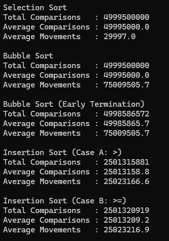
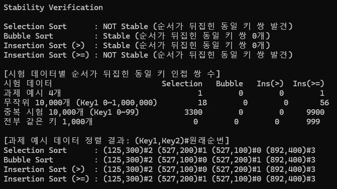
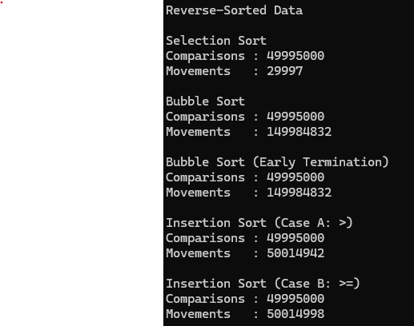
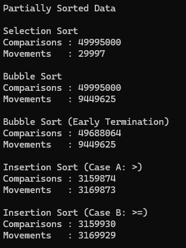

# 무작위 데이터 100회 실험에서 세 정렬 알고리즘의 총 및 평균 비교 횟수  
  

# 일반 버블 정렬과 조기 종료 버블 정렬의 비교 횟수 차이  
무작위 데이터에서는 조기 종료가 비교 횟수를 거의 줄이지 못합니다. 
이동 횟수는 완전히 같습니다. 교환 횟수는 입력의 역전 쌍 수로 정해지기 때문입니다. 
버블 정렬은 한 번 순회할 때마다 각 원소의 앞쪽에 있는 더 큰 원소가 하나씩 줄어듭니다. 
따라서 교환이 없는 순회가 처음 나타나는 시점은 
"앞쪽에 더 큰 원소가 가장 많은 원소"가 정리되는 때입니다. 
무작위 배열에는 작은 값이 뒤쪽에 있는 경우가 거의 항상 있어서, 
이 시점이 마지막 순회에 매우 가깝습니다. 
그래서 절약되는 것은 맨 끝의 몇 번뿐이고, 
그마저 비교 횟수가 적은 순회들이라 전체에서 차지하는 비율이 아주 작습니다. 
조기 종료는 입력이 이미 거의 정렬돼 있을 때만 효과가 큽니다.  

# 선택 정렬, 버블 정렬, 삽입 정렬의 안정성 검증 방법과 결과  
## 정렬 안정성을 검증하기 위해 사용한 방법  
각 데이터에 정렬 전 입력 순번(orig)을 저장했습니다.  
orig는 정렬 기준에 쓰지 않고 데이터와 함께 이동만 합니다.  
정렬 후 Key1이 같은 인접한 두 데이터 중 앞의 orig가 뒤의 orig보다 큰 쌍(순서가 뒤집힌 쌍)의 수를 셌습니다.  
같은 Key1은 정렬 결과에서 연속해 있으므로, 순서가 한 쌍이라도 바뀌었다면 인접 쌍에서 드러납니다.  
0이면 그 입력에서는 안정입니다.  

## 안정성 검증에 사용한 입력 데이터  
## 선택 정렬의 안정성 검증 결과  
## 버블 정렬의 안정성 검증 결과  
## 삽입 정렬의 안정성 검증 결과  
  

## 삽입 정렬에서 >와 >= 사용에 따른 차이  
'>'는 삽입할 값보다 엄격히 큰 데이터만 뒤로 밀고, 같은 키를 만나면 멈춥니다. 
따라서 같은 키 뒤에 들어가 원래 순서가 유지됩니다.  
'>='는 같은 키도 밀어내고 그 앞으로 파고듭니다. 
그래서 같은 키 그룹의 순서가 정확히 반대가 됩니다.  
중복 데이터의 9,900쌍은 10,000 − 100(그룹 수)이므로 같은 키 인접 쌍이 전부 뒤집힌 것입니다. 
전부 같은 키 1,000개는 완전히 역순이 되었습니다.  
'>='는 비교·이동도 늘립니다. 
정렬된 입력에서 비교가 9,999 → 10,055로 56회 늘었는데, 이는 같은 키 쌍의 수와 같습니다.  

## 각 결과가 발생한 원인에 대한 설명  
선택: 현재 위치의 데이터와 최솟값을 멀리 떨어진 위치끼리 교환합니다. 
이때 같은 키 데이터를 뛰어넘어 순서가 깨집니다. 최솟값을 고를 때 '<'를 써도 이 문제는 사라지지 않습니다.  
버블: 인접한 데이터끼리만, 그리고 a[j] > a[j+1]일 때만 교환합니다. 
같은 키끼리는 교환되지 않고 다른 데이터가 같은 키를 건너뛰지도 않아 순서가 유지됩니다.  
삽입: 비교 연산자가 같은 키를 앞에 둘지 뒤에 둘지를 정합니다(위 설명).  

# 삽입 정렬에서 >와 >=의 사용이 안정성에 미치는 영향  
'>'는 같은 키를 만나면 멈춰 안정이고, '>='는 같은 키를 앞질러 순서가 반대가 되어 불안정입니다.  
중복 데이터 기준으로 '>'는 0쌍, '>='는 9,900쌍이 뒤집혔습니다.  

# 이미 정렬된 데이터에서의 비교 횟수와 데이터 이동 횟수  
  

# 역순으로 정렬된 데이터에서의 비교 횟수와 데이터 이동 횟수  
  

# 일부 정렬된 데이터에서의 비교 횟수와 데이터 이동 횟수  
  

# 부분 정렬 데이터를 생성한 방법 및 인공지능 활용 내용  
생성 방법: 원본(100회 실험의 1회차 데이터)을 Key1 오름차순으로 정렬한 뒤, 
서로 다른 두 위치를 무작위로 골라 맞바꾸는 일을 500번 반복했습니다.  
인공지능 활용: 부분 정렬 데이터를 만드는 방법을 인공지능(Claude)에게 물어 후보를 조사했습니다. 
후보는 (1) 정렬된 배열에서 일부 위치 무작위 교환, 
(2) 일정 구간만 정렬하거나 섞기, (3) 각 원소를 근처에서 조금씩 흔드는 지역 교란이었습니다.  
이 중 교란 정도를 교환 쌍 수로 정할 수 있고 재현이 쉬운 (1)을 골랐습니다. 
(2)는 어느 구간을 섞느냐에 따라 결과가 크게 달라지고, 
(3)은 원소가 제자리 근처에만 머물러 조기 종료 효과를 보기 어려워 제외했습니다.  

# 입력 데이터의 초기 정렬 상태가 각 알고리즘의 성능에 미치는 영향  
선택 :  
비교(49,995,000)와 이동(29,997)이 입력 상태와 무관합니다. 
남은 구간 전체를 훑고 교환도 무조건 하기 때문입니다.
버블 (일반) :  
비교는 항상 49,995,000입니다. 
이동만 달라지며, 정렬 입력 0, 부분 정렬 약 945만, 무작위 약 7,500만, 
역순 약 1억 5,000만으로 늘어납니다.
버블 (조기 종료) :  
정렬 입력에서는 비교가 49,995,000 → 9,999로 약 5,000분의 1이 됩니다.
부분 정렬에서는 0.6%만 줄었습니다. 
소수의 원소가 멀리 어긋나 있으면 거의 끝까지 순회해야 하기 때문입니다.
역순에서는 절약이 0입니다.  
삽입 :  
입력 상태에 가장 민감합니다. 
정렬 입력은 비교 9,999, 이동 19,998입니다. 
부분 정렬은 비교 약 316만으로 무작위의 12.6%입니다. 
역순은 비교 49,995,000, 이동 약 5,001만으로 최악입니다.  

# 각 정렬 알고리즘의 성능 차이가 발생하는 원인에 대한 분석  
선택 :  
비교는 많지만 이동이 가장 적습니다. 한 번의 교환으로 원소를 최종 위치에 바로 보내기 때문입니다.  
대신 정렬 상태를 전혀 활용하지 못합니다.  
버블 :  
교환은 인접한 한 칸씩만 일어나므로 이동 = 3 × 역전 수입니다. 
같은 역전 수에서 삽입보다 이동이 3배입니다. 
교환은 두 데이터를 쓰는데 삽입의 밀기는 한 데이터만 쓰기 때문입니다. 
그래서 역순에서 이동이 약 1억 5,000만으로 가장 큽니다.  
삽입 :  
비교와 이동이 역전 수에 비례합니다. 
정렬된 입력에서는 원소마다 비교 1번으로 끝나 매우 빠릅니다. 
이동은 원소당 최소 2회(임시 저장과 최종 대입)입니다.  