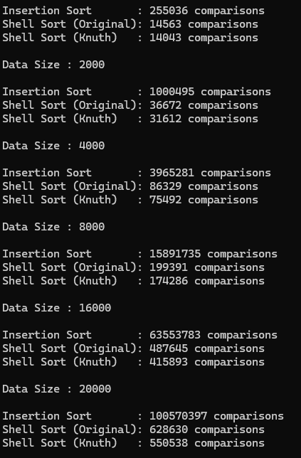

# 데이터 크기 증가에 따른 삽입 정렬과 쉘 정렬의 비교 횟수 변화  
  

# 삽입 정렬과 쉘 정렬의 성능 차이  
쉘 정렬이 모든 크기에서 비교 횟수가 훨씬 적었고, n이 클수록 차이가 커졌습니다. 
20회 평균으로 보면 삽입 정렬은 쉘 정렬(기본 간격)의 16.7배(n=1,000)에서 160.1배(n=20,000)로 늘어났습니다. 
Knuth 간격과 비교하면 18.2배에서 181.5배입니다.  

크기가 커질 때의 증가 방식이 다릅니다.  

삽입 정렬: n이 2배가 되면 비교가 약 4배가 됩니다(251,712 → 999,978 → 4,008,524). 
증가 지수가 1.99~2.00이어서 n²에 비례합니다. n당 비교 횟수도 252에서 4,999로 20배 가까이 커집니다.  
쉘 정렬: 증가 지수가 1.2~1.27 정도입니다. 
n당 비교 횟수는 기본 간격이 15.05에서 31.22, Knuth가 13.86에서 27.54로 2배 정도만 커집니다.  

원인은 이동 거리입니다. 삽입 정렬은 원소를 한 칸씩만 움직이므로 비교 횟수가 역전 쌍의 수와 같아집니다. 무작위 배열의 역전 쌍은 평균 약 n²/4라서, n=20,000에서 약 1억 번(측정값 99,975,839)이 됩니다. 멀리 떨어진 원소를 제자리로 보내려면 그 거리만큼 비교해야 하기 때문입니다. 쉘 정렬은 큰 간격으로 멀리 떨어진 원소끼리 먼저 비교·교환해서 한 번에 먼 거리를 옮깁니다. 이렇게 큰 간격 단계를 거치면 배열이 어느 정도 정렬되어, 마지막에 간격 1로 삽입 정렬을 할 때는 거의 정렬된 상태입니다. 
삽입 정렬은 거의 정렬된 입력에서 원소당 비교 한두 번이면 끝나므로 마지막 단계가 아주 싸집니다.  

# 쉘 정렬의 기본 간격과 Knuth 수열의 성능 차이  
6개 크기 모두에서 Knuth 간격이 기본 간격보다 비교가 적었습니다. 
1회 실험(n=1,000에서 14,043 대 14,563, n=20,000에서 550,538 대 628,630)도, 20회 평균도 같았습니다. 
평균 기준으로 줄어든 비율은 n=1,000에서 7.9%, n=16,000에서 15.7%, n=20,000에서 11.8%입니다. 
전체적으로 8~16% 정도입니다.  

차이의 주된 원인은 단계 수입니다. 
간격 g의 단계는 원소마다 최소 한 번은 비교해야 해서 적어도 (n−g)번이 듭니다.  

단계 수는 기본 간격이 9단계(n=1,000)에서 14단계(n=20,000)로 늘고, Knuth는 6단계에서 9단계로 늡니다. 
그래서 단계별 최소 비용의 합은 n=20,000에서 기본 260,005, Knuth 165,243입니다. 
Knuth가 약 9만 5천 번 적습니다.  
반면 그 고정 비용을 뺀 "나머지"는 두 방식이 비슷합니다. 
n=1,000~8,000과 20,000에서는 오히려 Knuth가 더 큽니다(n=20,000에서 364,355 대 385,468). 
n=16,000에서만 Knuth가 적습니다(296,099 대 282,141).  

# 간격 수열이 쉘 정렬의 성능에 영향을 미치는 이유  
단계 수가 고정 비용을 정합니다. 모든 단계는 원소를 한 번씩은 훑어야 합니다. 
기본 간격은 절반씩 줄이기 때문에 n이 커질수록 단계가 하나씩 늘어납니다. 
간격 수열을 보면 n=20,000에서 기본 간격은 10000 5000 2500 … 2 1로 14단계이고, 
Knuth는 9841 3280 1093 364 121 40 13 4 1로 9단계입니다. 
Knuth는 간격이 약 3배씩 줄어서 단계가 느리게 늘어납니다.  
큰 간격이 먼 거리의 역전을 한꺼번에 없앱니다. 
이 효과가 삽입 정렬과 쉘 정렬의 차이를 만듭니다. 
큰 간격 단계를 거치면 마지막 간격 1 단계가 거의 정렬된 배열을 상대합니다. 
간격이 없는 삽입 정렬은 이 이득이 전혀 없습니다.  
이웃한 간격의 관계가 효과를 좌우합니다. 
Knuth 수열의 이웃한 두 간격 h와 3h+1은 항상 서로소입니다(최대공약수가 gcd(h, 1) = 1). 
그래서 단계마다 서로 다른 원소 쌍이 새롭게 섞입니다. 
반면 기본 간격은 이웃한 간격이 약수·배수 관계(10000, 5000, 2500, 1250)라서, 
앞 단계에서 이미 같은 묶음끼리 정렬한 원소들을 다시 다루는 일이 많아 효과가 줄어듭니다.  
간격을 줄이는 속도에는 균형이 필요합니다. 
너무 천천히 줄이면 단계가 많아져 고정 비용이 늘어납니다. 기본 간격이 이 경우입니다. 
너무 빠르게 줄이면 마지막 간격 1 단계에 남는 무질서가 많아져 그 단계가 비싸집니다. 
Knuth는 간격이 4에서 1로 한 번에 줄기 때문에 이 단점이 조금 있습니다. 
나머지 비용이 기본 간격보다 같거나 큰 크기가 많은 것도 이 영향으로 볼 수 있습니다. 