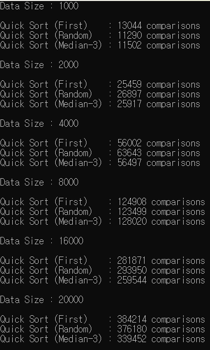

# 데이터 크기 증가에 따른 세 가지 퀵 정렬의 비교 횟수 변화  

# 첫 번째 원소, 무작위 원소, 세 원소의 중앙값을 피벗으로 선택했을 때의 성능 차이  
한 번만 실행한 결과로는 어느 방법이 낫다고 말하기 어렵다.  
세 방법 모두 데이터가 2배가 될 때 비교 횟수가 2배보다 조금 많게 늘었다. 
이것이 n log n 정도로 늘어나는 모습이다.  
세 원소의 중앙값이 모든 크기에서 가장 적었고 첫 원소와 무작위 원소는 거의 같았다.  

# 피벗 선택 방법이 분할 결과와 비교 횟수에 영향을 미치는 이유  
퀵 정렬은 피벗을 기준으로 데이터를 둘로 나눈다. 
반씩 고르게 나눌수록 빨리 끝나고, 한쪽으로 치우칠수록 오래 걸린다.  
첫 원소와 무작위가 같은 이유 : 데이터가 무작위로 섞여 있으면 첫 원소도 아무 위치의 값이다. 
그래서 첫 원소를 고르나 무작위로 고르나 차이가 없다. 
중앙값이 나은 이유 : 세 값 중 가운데 값을 고르면 한 값을 고를 때보다 데이터의 가운데에 가까운 값이 걸린다. 
그래서 더 고르게 나뉘고, 단계가 줄어들어 비교도 줄어든다.  

# 어떤 피벗 선택 방법이 효과적이었는지 실험 결과를 바탕으로 분석  
이번 과제의 무작위 데이터에서는 세 원소의 중앙값이 가장 좋았다. 
모든 크기에서 가장 적었고, 더 고르게 나뉘었다.  
무작위 원소는 이번 데이터에서는 첫 원소와 비슷했다. 하지만 데이터 모양이 어떻든 안정적이라는 장점이 있다.  
정리하면, 데이터가 무작위일 때는 중앙값이 가장 효율적이었다. 
데이터가 어떤 모양일지 모르는 경우에는 무작위 원소가 가장 안전했고, 첫 원소는 정렬된 데이터에서 가장 나빴다.  

# [보너스] 재귀적 방법과 반복적 방법의 실행시간 차이를 분석하고, 이러한 차이가 발생한 이유  
실행시간 차이는 거의 없었다. 
n=10,000, 세 원소의 중앙값 기준으로 재귀는 1.3946ms, 반복은 1.3573ms로 반복이 약 3% 빨랐다. 
피벗 방법과 크기를 바꿔 봐도 반복이 2~4% 빠른 정도였다.  
차이가 거의 없는 이유 : 
두 방법은 데이터를 나누는 방식과 피벗 고르는 방식이 완전히 같다. 
비교 횟수와 정렬 결과도 똑같았다.  
시간의 대부분은 데이터를 나누는 작업에 쓰인다.  
둘의 차이는 아직 처리하지 않은 구간을 기억해 두는 방법뿐이다. 
재귀는 함수를 호출해서, 반복은 스택에 넣어서 기억하는데, 둘 다 데이터를 나누는 작업에 비하면 아주 작은 일이다.  