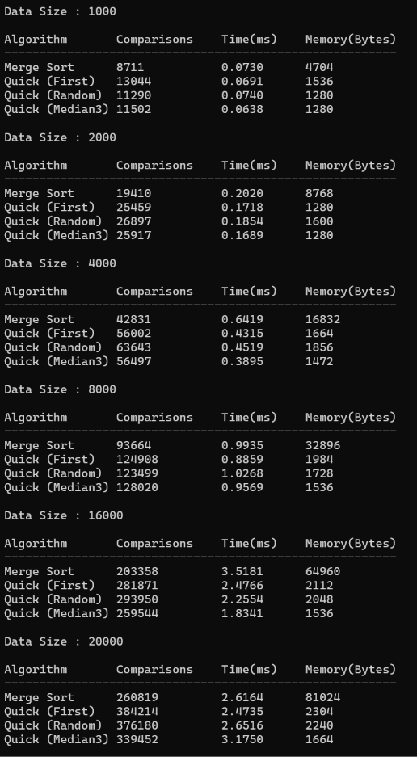

# 데이터 크기 증가에 따른 병합 정렬과 퀵 정렬의 비교 횟수 변화  
  
두 알고리즘 모두 n이 커질수록 비교 횟수가 n보다 조금 빠르게 늘어납니다(n log n 꼴).  
병합 정렬은 입력 순서와 상관없이 항상 정확히 반으로 나누므로 값이 일정하게 늘어납니다.  
퀵 정렬은 피벗이 정확히 가운데가 되지 못해서 병합 정렬보다 비교를 약 1.3~1.4배 더 합니다. 
데이터에 따라 값도 들쭉날쭉합니다.  

# 두 정렬 알고리즘의 실행시간 차이  
비교는 병합 정렬이 더 적었지만, 시간은 퀵 정렬이 더 빨랐습니다.  
병합 정렬은 임시 배열로 복사했다가 되돌려 쓰는 작업이 많고, 메모리 할당과 해제도 필요합니다.  
퀵 정렬은 제자리에서 교환만 하고 배열을 순서대로 훑기 때문에 비교 한 번당 드는 일이 적습니다.  

# 두 정렬 알고리즘의 메모리 사용량 차이  
병합 정렬은 임시 배열(약 4n Byte) 때문에 n에 비례해 커졌습니다.  
퀵 정렬은 재귀 스택만 써서 크기가 거의 변하지 않았고 1~2KB 정도였습니다.  
n이 커질수록 둘의 차이는 더 벌어집니다.  

# 퀵 정렬의 피벗 선택 방법에 따른 성능 차이  
First: 구현은 가장 간단합니다. 하지만 이미 정렬된 데이터에서는 분할이 한쪽으로 쏠려 매우 느려지고, 재귀가 너무 깊어질 수 있습니다.  
Random: 입력 순서와 상관없이 평균적으로 괜찮지만, 운에 따라 결과가 흔들립니다.  
Median-of-Three: 극단적인 값을 피벗으로 고를 확률이 낮아 분할이 고릅니다. 평균 비교 횟수가 가장 적었고 재귀 깊이도 가장 얕았습니다. 
가장 안정적이었습니다.  

# 병합 정렬과 퀵 정렬의 시간 복잡도 및 공간 복잡도 차이  
||시간(최선/평균)|시간(최악)|공간|
|------|------|------|------|
|병합 정렬|O(n log n)|O(n log n)|O(n)|
|퀵 정렬|O(n log n)|O(n²)|O(log n) (최악 O(n))|

병합 정렬은 어떤 입력에서도 속도가 보장되지만 추가 메모리가 필요합니다.  
퀵 정렬은 최악의 경우가 있지만, 피벗을 잘 고르면 평균에 가깝게 동작하고 추가 메모리가 거의 필요 없습니다.  

# 메모리 사용량의 측정 방법과 계산 기준  
프로파일링 도구 없이 직접 계산했습니다. 메모리 = 추가 배열 + 재귀 호출 스택입니다.  
추가 배열은 정렬 중 malloc으로 잡은 양을 실제로 세어서 구했습니다. 병합 정렬은 임시 배열로 4n Byte, 퀵 정렬은 0입니다.  
재귀 스택은 (최대 재귀 깊이 + 1) × 64 Byte로 계산했습니다. 깊이는 실행 중에 직접 센 값이고, 64 Byte는 호출 한 번이 쓰는 공간을 넉넉히 잡은 가정값입니다.
