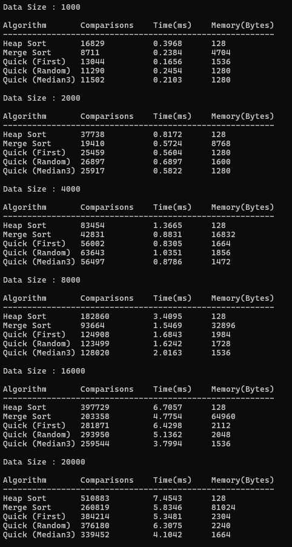

# 데이터 크기 증가에 따른 세 정렬 알고리즘의 비교 횟수 변화  
  
세 알고리즘 모두 n이 커질수록 비교 횟수가 n보다 조금 빠르게 늘어납니다(n log n 꼴).  
같은 n log n이어도 곱해지는 상수가 달라서 개수 차이가 납니다.  
병합 정렬이 가장 적었습니다. 항상 정확히 반으로 나누므로 입력 순서와 상관없이 일정하게 늘어납니다.  
퀵 정렬은 병합 정렬보다 약 1.3~1.4배 많았습니다. 
피벗이 정확히 가운데에 떨어지지 않아 분할이 한쪽으로 기울기 때문입니다.  
힙 정렬이 가장 많았고, 병합 정렬의 약 1.95배였습니다. 
한 칸 내려갈 때마다 비교를 2번(자식끼리, 부모와 큰 자식) 하고, 
정렬 단계에서는 맨 뒤의 작은 값을 루트에 올려 놓고 내리기 때문에 거의 바닥까지 내려갑니다.  

# 힙 정렬, 병합 정렬, 퀵 정렬의 실행시간 차이  
가장 빠른 것은 퀵 정렬(First, Median3)이었고, 다음이 병합 정렬, 가장 느린 것은 힙 정렬이었습니다.  
병합 정렬은 비교는 가장 적지만 임시 배열로 복사했다가 되돌려 쓰는 작업이 많아서 퀵 정렬보다 느렸습니다.  
퀵 정렬은 제자리에서 배열을 앞뒤로 순서대로 훑으며 교환만 해서 비교 한 번당 드는 일이 적습니다.  
힙 정렬은 비교가 가장 많은 데다, 
부모에서 자식으로 멀리 떨어진 위치를 건너뛰며 접근해서 메모리 접근에도 불리해서 가장 느렸습니다.  

# 세 정렬 알고리즘의 메모리 사용량 차이  
힙 정렬은 128 Byte로 n과 상관없이 일정했습니다. 별도 배열도 재귀도 없고, 입력 배열 자체를 힙으로 씁니다.  
퀵 정렬은 약 1~2KB였습니다. 재귀 스택만 쓰고, 재귀 깊이에 따라 조금 달라집니다.  
병합 정렬은 임시 배열(약 4n Byte) 때문에 n에 비례해 커졌습니다. n이 클수록 다른 둘과의 차이가 더 벌어졌습니다.  

# 퀵 정렬의 피벗 선택 방법에 따른 성능 차이  
First: 구현이 가장 단순하고 피벗 선택 비용이 없어 무작위 데이터에서는 시간이 빠른 편이었습니다. 
하지만 이미 정렬된 데이터에서는 분할이 한쪽으로 쏠려 매우 느려지고 재귀가 너무 깊어질 수 있습니다.  
Random: 입력 순서와 상관없이 평균적으로 괜찮지만, 운에 따라 결과가 흔들립니다. 
난수 생성 비용 때문에 시간은 First보다 느렸습니다.  
Median-of-Three: 극단적인 값을 피벗으로 고를 확률이 낮아 분할이 고릅니다. 
평균 비교 횟수와 재귀 깊이가 가장 적었고 가장 안정적이었습니다.  
세 방법 모두 병합 정렬보다 비교는 많았지만, 힙 정렬보다는 적었습니다.  

# 세 정렬 알고리즘의 시간 복잡도 및 공간 복잡도 비교  
||시간(최선/평균)|시간(최악)|공간|
|------|------|------|------|
|힙 정렬|O(n log n)|O(n log n)|O(1)|
|병합 정렬|O(n log n)|O(n log n)|O(n)|
|퀵 정렬|O(n log n)|O(n²)|O(log n) (최악 O(n))|

힙 정렬은 최악에도 시간이 보장되고 추가 메모리도 상수라서, 
시간과 공간을 모두 보장하는 알고리즘입니다. 다만 실험에서는 상수가 커서 가장 느렸습니다.  
병합 정렬은 시간이 보장되고 비교도 가장 적지만 O(n) 메모리가 필요합니다.  
퀵 정렬은 최악의 경우가 있지만 피벗을 잘 고르면 평균에 가깝게 동작하고, 
실제로 가장 빠르고 메모리도 적게 썼습니다.  

# 메모리 사용량의 측정 방법과 계산 기준  
프로파일링 도구 없이 직접 계산했습니다. 메모리 = 추가 배열 + 호출 스택입니다.
추가 배열은 정렬 중 malloc으로 잡은 양을 실제로 세었습니다. 병합 정렬은 임시 배열 4n Byte이고, 
힙 정렬과 퀵 정렬은 0입니다.  
호출 스택은 (최대 호출 깊이 + 1) × 64 Byte로 계산했습니다. 
64 Byte는 호출 한 번이 쓰는 공간을 넉넉히 잡은 가정값입니다.  
퀵 정렬과 병합 정렬은 재귀 깊이를 실행 중에 직접 센 값을 썼습니다.  
힙 정렬은 재귀가 없고, 동시에 살아 있는 호출이 heap_sort와 sift_down 둘뿐이라 2 × 64 = 128 Byte입니다.  
