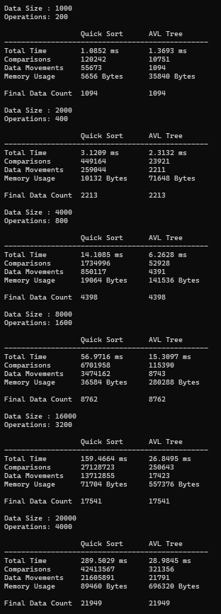

# 두 방법의 총 수행시간 및 비교 횟수 차이  
  
비교 횟수는 AVL이 훨씬 적었고, 데이터가 커질수록 그 차이가 더 벌어졌습니다.  
총 수행시간은 데이터가 작을 때는 거의 비슷했지만, 데이터가 커지자 AVL이 크게 빨라졌습니다.  
정렬(구축) 단계는 퀵 정렬이 더 빨랐습니다. 
퀵 정렬은 제자리에서 교환만 하지만, 
AVL은 노드를 하나씩 할당하고 트리를 따라 내려가며 회전하기 때문입니다.  
삽입·삭제 단계는 AVL이 압도적으로 빨랐습니다. 
배열은 선형 탐색이라 연산마다 평균 절반 정도를 훑지만, AVL은 트리 높이만큼만 내려갑니다.  
퀵 정렬 쪽은 전체 시간의 대부분이 삽입·삭제에 쓰여서, 연산 단계가 전체 차이를 만들었습니다.  

# 삽입·삭제 과정에서 발생하는 데이터 이동 횟수 차이  
이동 횟수는 배열이 AVL보다 압도적으로 많았습니다.  
배열은 삽입·삭제할 때마다 뒤쪽 원소를 전부 한 칸씩 밀거나 당겨야 합니다. 
그래서 연산 1회당 이동이 데이터 크기에 비례해 늘었습니다.  
AVL은 값을 옮기지 않고 포인터 연결만 바꿉니다. 
이동은 새 노드에 값을 저장할 때 정도만 생겨서 연산당 거의 일정했습니다. 
회전도 포인터만 바꾸므로 이동에 들어가지 않습니다.  

# 배열과 AVL 트리의 메모리 사용량 차이  
메모리는 배열이 유리했고, AVL은 배열보다 몇 배 더 썼습니다.  
배열은 원소 하나에 값만 저장하는 연속 공간이라 낭비가 거의 없습니다.  
AVL은 노드마다 값 외에 중복 횟수, 높이, 왼쪽·오른쪽 포인터가 붙어서 원소 하나당 필요한 공간이 훨씬 큽니다. 
이번 데이터는 중복이 거의 없어서 중복 횟수로 아끼는 효과도 작았습니다.  
재귀 스택은 두 방법 모두 데이터 저장 공간에 비하면 작았습니다.  

# 데이터 크기 증가에 따른 성능 변화  
데이터가 커질수록 배열은 시간이 n²에 가깝게 급증했고, AVL은 n log n 꼴로 완만하게 늘었습니다.  
연산 횟수도 데이터 크기에 비례해 늘기 때문에, 
배열은 "연산 수 × 연산당 n"이라 n²이 되고, AVL은 "연산 수 × 연산당 log n"이 됩니다.  
그래서 비교 횟수와 이동 횟수의 차이는 데이터가 클수록 더 벌어졌습니다.  
메모리의 비율은 데이터가 커져도 거의 일정했습니다. 노드 하나의 크기 비율이 정해져 있기 때문입니다.  

# 삽입·삭제가 반복되는 환경에서 유리한 자료구조와 그 이유  
삽입·삭제가 많으면 AVL 트리가 유리합니다.  
정렬된 배열은 연산 한 번이 O(n)입니다. 
위치를 찾으려고 평균 절반을 훑고, 뒤쪽 원소를 평균 절반 정도 옮겨야 하기 때문입니다.  
AVL은 탐색, 삽입, 삭제, 균형 복구가 모두 O(log n)이고 데이터를 옮기지 않습니다.  
다만 AVL이 항상 이기는 것은 아닙니다. 
처음 정렬(구축)은 퀵 정렬이 더 빠르고, 메모리도 AVL이 더 많이 씁니다. 
그래서 연산 횟수가 충분히 많아야 AVL이 이득입니다.  
데이터가 클수록 더 적은 비율의 연산만으로도 AVL이 이득이 됩니다.  
반대로 삽입·삭제가 거의 없고 읽기만 하거나, 메모리가 매우 부족하거나, 
인덱스로 바로 접근해야 한다면 배열이 낫습니다.  
