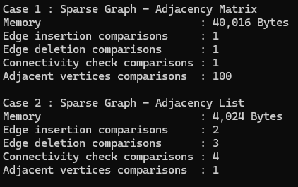
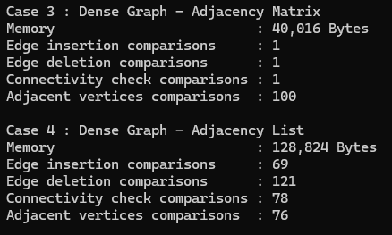

# 4가지 경우에서 측정한 메모리 사용량  
# 간선 삽입 및 삭제의 비교 횟수  
# 두 정점의 연결 여부 확인에 필요한 비교 횟수  
# 특정 정점의 인접 정점 출력에 필요한 비교 횟수  
 
 

# 희소 그래프에서 인접 행렬과 인접 리스트의 차이에 대한 분석  
위 사진의 결과값으로 희소그래프에서 인접 행렬과 인접 리스트의 차이에 대해 분석해보겠다.  
### 메모리  
행렬은 40016바이트, 리스트는 4024바이트가 나왔다.  
행렬은 간선 수와 무관하게 칸수가 정점 수의 제곱으로 공간이 정해져있다.  
리스트는 간선 수와 비례해서 공간이 생긴다.  
### 간선 삽입 및 삭제  
간선 삽입은 행렬은 비교 1회, 리스트는 비교 2회이다.  
간선 삭제는 행렬은 비교 1회, 리스트는 비교 3회이다.  
행렬은 이차원배열을 직접 확인하므로 삽입과 삭제 둘 다 항상 1회이다.  
리스트는 앞에서부터 차례로 확인해야하므로 삽입과 삭제 둘 다 차수에 비례한다.  
### 두 정점의 연결 여부 확인  
행렬은 비교 1회, 리스트는 비교 4회이다.  
행렬은 이차원배열을 직접 확인하므로 항상 1회이다.  
리스트는 앞에서부터 차례로 확인해야하므로 차수에 비례한다.  
### 특정 정점의 인접 정점 출력에 필요한 비교 횟수  
행렬은 비교 100회, 리스트는 1회이다.  
행렬은 이차원배열 한 줄을 모두 확인해야하기 때문에 항상 100회이다.  
리스트는 앞에서부터 차례로 확인하므로 차수만큼만 확인하면 된다.  
## 차이에 대한 분석  
희소 그래프에서는 리스트의 단점인 차수에 비례하는 탐색이 차수 평균이 2 정도이므로 
거의 드러나지 않고 장점인 메모리와 인접 정점 열거는 그대로 살아난다.  
행렬이 이기는 항목에서도 격차는 1회 대 2~4회 수준에 불과하다.  
반대로 행렬은 98%의 칸이 0인 채 40KB를 차지하고, 
정점 하나의 이웃을 찾을 때마다 대부분 0인 100칸을 읽는다.  
고로 희소 그래프에서는 리스트가 합리적인 선택이라고 볼 수 있다.  

# 밀집 그래프에서 인접 행렬과 인접 리스트의 차이에 대한 분석  
### 메모리  
행렬은 40016바이트, 리스트는 128824바이트가 나왔다.  
행렬은 간선 수와 무관하게 칸수가 정점 수의 제곱으로 공간이 정해져있다.  
리스트는 간선 수와 비례해서 공간이 생긴다.  
### 간선 삽입 및 삭제  
간선 삽입은 행렬은 비교 1회, 리스트는 비교 69회이다.  
간선 삭제는 행렬은 비교 1회, 리스트는 비교 121회이다.  
행렬은 이차원배열을 직접 확인하므로 삽입과 삭제 둘 다 항상 1회이다.  
리스트는 앞에서부터 차례로 확인해야하므로 삽입과 삭제 둘 다 차수에 비례한다.  
### 두 정점의 연결 여부 확인  
행렬은 비교 1회, 리스트는 비교 78회이다.  
행렬은 이차원배열을 직접 확인하므로 항상 1회이다.  
리스트는 앞에서부터 차례로 확인해야하므로 차수에 비례한다.  
### 특정 정점의 인접 정점 출력에 필요한 비교 횟수  
행렬은 비교 100회, 리스트는 76회이다.  
행렬은 이차원배열 한 줄을 모두 확인해야하기 때문에 항상 100회이다.  
리스트는 앞에서부터 차례로 확인하므로 차수만큼만 확인하면 된다.  
## 차이에 대한 분석  
밀집 그래프에서는 희소 그래프와 완전 다른 결과가 나온다.  
행렬은 대부분의 칸이 실제 간선이라 낭비가 적고, 한 칸으로 거의 모든 정보를 담고 표현한다.  
리스트는 노드를 8000개나 만들어 메모리가 더 들고, 
길어진 리스트를 앞에서부터 확인하느라 삽입·삭제·연결 확인이 모두 수십 배 느려진다.  
리스트가 앞서는 유일한 항목은 인접 정점 열거인데 100대 76으로 얼마 차이가 나지 않는다.  
고로 밀집 그래프에서는 행렬이 합리적인 선택이라고 할 수 있다.  

# 어떤 경우에 인접 행렬 또는 인접 리스트를 사용하는 것이 적절한지에 대한 분석  
인접 리스트가 적절한 경우는 희소 그래프, 메모리가 중요한 경우, 
인접 정점을 열거하는 알고리즘을 구현할 때 등이 있다.  
인접 행렬이 적절한 경우는 밀집 그래프, 삽입·삭제·연결 확인 같은 개별 간선 수정이 잦을 때이다.  