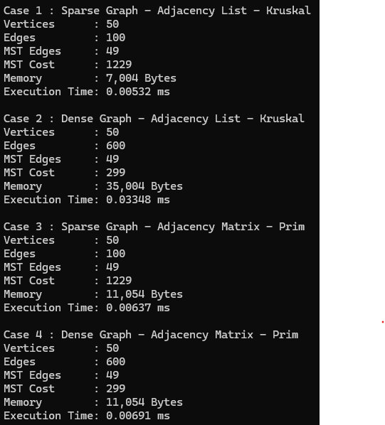
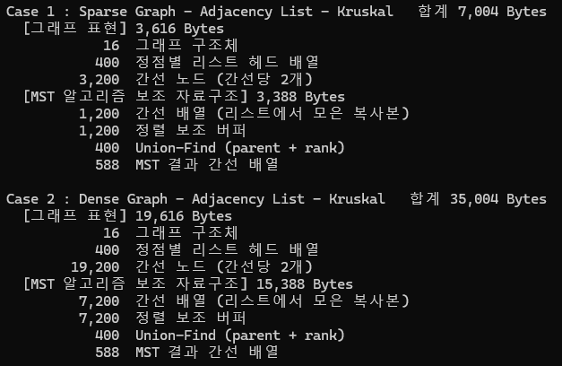

# 각 경우의 MST 전체 비용과 간선 수  
# 각 경우의 메모리 사용량  
# 각 경우의 실행시간  
  

# 희소 그래프와 밀집 그래프에서의 성능 차이  
크루스칼은 그래프가 밀집해지면 느려진다. 
희소 그래프는 0.00532ms가 나온 반면 밀집 그래프는 0.03348msfh 약 6배가 늘었다.  
간선이 6배로 늘면서 정렬해야 할 양이 늘었기 때문이다.  
하지만 프림은 거의 변하지 않는다.  
희소 그래프에서 0.00637ms지만 밀집 그래프에서 0.00691ms로 얼마 차이가 나지 않는다.  
읽는 칸 수가 두 경우 모두 2500회로 같기 때문이다.  

# 인접 리스트와 인접 행렬의 메모리 사용 차이  
인접 리스트는 간선 수에 비례한다.  
희소 그래프 7004바이트 밀집 그래프 35004바이트이며 
무방향 그래프라 간선 하나가 노드 2개로 저장된다.  
인접 행렬은 간선 수와 상관없이 항상 11054바이트이다.  
정점 50개로 항상 2500칸 고정이기 때문이다.  
참고로 위 메모리는 알고리즘 보조 공간까지 합친 메모리이다.  
  
  
위 사진은 세부 메모리이다.  

# Kruskal 알고리즘과 Prim 알고리즘의 실행 특성 차이  
크루스칼은 간선 중심으로 간선을 가중치순으로 정렬해 가벼운 것부터 채택한다.  
고로 시간은 간선 수에 비례하며 (E log E)이다.  
크루스칼은 MST 간선 49개를 채우면 멈추지만 정렬은 미리 전부 해야하기 때문이다.  
밀집 그래프에서 600개를 모두 정렬하고도 실제로 검사한 간선은 90개로 대부분의 시간이 정렬에 쓰였다.  
프림은 정점 중심으로 한 정점에서 시작해 트리 하나를 키운다.   
고로 시간은 정점 수에 비례하며 (V^2)이다.  
프림은 간선 수와 상관없이 정해진 횟수를 돈다.  
보조 메모리도 크루스칼은 간선 수, 프림은 정점 수에 비례한다.  

# 그래프의 밀도가 각 방법의 성능에 미치는 영향  
크루스칼은 밀도가 올라갈수록 계속 느려진다.  
간선 수에 비레하기 때문이다.  
그래서 메모리도 밀도가 올라가면 계속 많이 차지한다.  
프림은 밀도가 올라가도 거의 그대로이다.  
정점 수에 비례하기 때문이다.  
그래서 메모리는 처음 정해둔 정점 수만큼 정해져있다.  